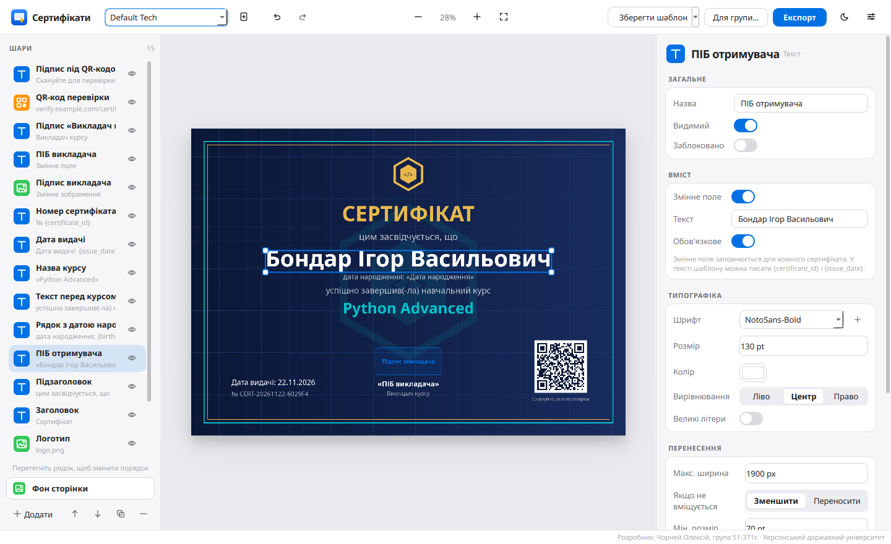
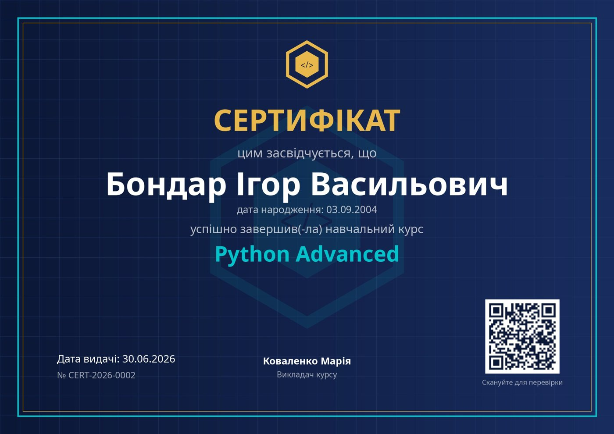
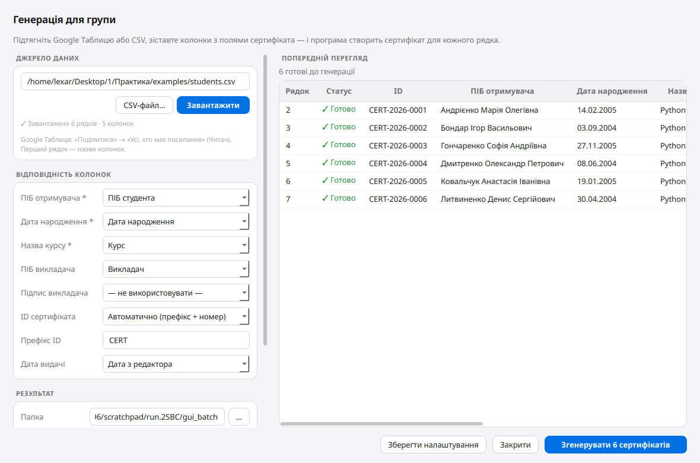

# Генератор сертифікатів


-41CD52?logo=qt&logoColor=white)


Настільна програма та Python-бібліотека для створення сертифікатів: візуальний редактор шаблонів, генерація сертифікатів для цілої групи з **Google Таблиці** або CSV і команда для автоматизації.
Результат — JPG, PNG або PDF (окремі файли або один спільний PDF для друку).

> Розроблено під час **виробничої практики** студентом **Чорнеєм Олексієм**, група **51-371с**,
> **Херсонський державний університет**, 2026.



---

## Зміст

- [Можливості](#можливості)
- [Встановлення](#встановлення)
- [Візуальний редактор](#візуальний-редактор)
- [Сертифікати для всієї групи](#сертифікати-для-всієї-групи)
- [Автоматизація: `batch.py`](#автоматизація-batchpy)
- [Використання з коду](#використання-з-коду)
- [Формат шаблону `config.json`](#формат-шаблону-configjson)
- [Архітектура](#архітектура)
- [Обробка помилок](#обробка-помилок)
- [Тести](#тести)
- [Структура проєкту](#структура-проєкту)
- [Ліцензії сторонніх ресурсів](#ліцензії-сторонніх-ресурсів)
- [Про проєкт](#про-проєкт)

---

## Можливості

**Редактор**
- Усе на сертифікаті переміщується мишею й змінює розмір за кути; розумні напрямні прилипають до країв
  і центрів сторінки та інших об'єктів.
- Шари чотирьох типів: **текст**, **зображення** (логотип, підпис), **водяний знак**, **QR-код**.
- Для кожного шару — прозорість, обертання, видимість; для тексту — шрифт, розмір, колір із прозорістю,
  вирівнювання, автоматичне зменшення або перенос довгого тексту.
- Свій фон, водяні знаки й зображення з будь-якого PNG/JPG — файл автоматично копіюється в шаблон;
  фон можна заповнити, вмістити або розтягнути.
- Скасування/повтор усіх дій, сповіщення з кнопкою «Скасувати», живий перегляд, що збігається з
  фінальним файлом до пікселя.

**Генерація для групи**
- Підтягування **Google Таблиці** за посиланням (без входу в акаунт) або CSV-файлу.
- Вибір, яка колонка відповідає якому полю сертифіката (ПІБ, дата народження, курс, викладач…);
  автоматичний підбір колонок за назвами.
- Перевірка кожного рядка до генерації: рядки з помилками підсвічуються й пропускаються.
- Окремий файл на кожного студента з назвою за шаблоном (`Бондар_Ігор_Васильович.pdf`) і, за бажанням,
  спільний PDF для друку.
- Налаштування групи зберігаються — повторна генерація однією командою, у тому числі за розкладом.

**Сертифікат**
- Унікальний номер і QR-код для перевірки автентичності.
- Будь-які поля в тексті через плейсхолдери: `дата народження: {birth_date}`.
- Повна підтримка кирилиці (у комплекті шрифти Noto Sans).

<p align="center"></p>

---

## Встановлення

Потрібен **Python 3.10+**. У Linux для інтерфейсу також потрібні системні бібліотеки Qt (зазвичай уже є
в будь-якому графічному середовищі).

```bash
git clone https://github.com/Lexar522/certificate-generator.git
```

```bash
cd certificate-generator
```

```bash
python -m venv .venv
```

Активація середовища — Linux / macOS:

```bash
source .venv/bin/activate
```

Windows (PowerShell):

```powershell
.venv\Scripts\Activate.ps1
```

```bash
pip install -r requirements.txt
```

Демо-ресурси (фон, логотип, водяний знак, тестовий підпис, шрифти) уже лежать у репозиторії.
Перегенерувати їх можна командою (шрифти Noto Sans копіюються із системи, якщо їх немає в шаблоні):

```bash
python -m tools.generate_demo_assets
```

---

## Візуальний редактор

```bash
python app.py
```

Вікно складається з трьох частин: **шари** ліворуч, **сертифікат** у центрі, **інспектор властивостей**
праворуч. Клік по порожньому місцю відкриває налаштування документа: номер і дата сертифіката, розмір і
фон полотна, формат експорту.

### Робота з об'єктами

| Дія | Як |
|---|---|
| Перемістити | Перетягнути мишею; стрілки — на 1 px, `Shift`+стрілки — на 10 px |
| Змінити розмір | Виділити й тягнути за будь-який кут (пропорційно, протилежний кут лишається на місці) |
| Вирівняти по центру | «↔ По центру» / «↕ По центру» в інспекторі або в меню правого кліку |
| Редагувати текст | Подвійний клік по тексту або `Enter` |
| Прозорість, поворот | Слайдери «Прозорість» і «Обертання» в інспекторі |
| Змінити порядок | Перетягнути рядок у списку шарів або «Підняти/Опустити» |
| Сховати | Іконка ока в списку шарів |
| Дублювати / видалити | `Ctrl+D` / `Delete` (або правий клік) |

### Свій фон

Кнопка **«Фон сторінки»** під списком шарів (або «+ Додати» → «Фонове зображення…») → **«Обрати
зображення…»** — підійде будь-який JPG/PNG, файл копіюється в шаблон. Спосіб вписування:
**«Заповнити»** (без порожніх країв, зайве обрізається), **«Вмістити»** (видно все зображення, краї —
колір фону) або **«Розтягнути»**. Там само — колір фону та розмір сторінки.

### Водяні знаки

«+ Додати» → «Водяний знак» → оберіть PNG (краще з прозорим фоном). Далі його можна перетягувати,
масштабувати за кути, змінювати прозорість і кут повороту. Водяних знаків може бути скільки завгодно.

### Змінні поля

Текстовий шар може бути **статичним** (однаковим для всіх) або **змінним полем** — тоді значення
підставляється для кожного сертифіката окремо (з таблиці групи). Перемикач «Змінне поле» в інспекторі.
У статичному тексті також можна використовувати плейсхолдери: `{certificate_id}`, `{issue_date}` і будь-які
власні поля, наприклад `{birth_date}`.

### Збереження та експорт

- **Зберегти шаблон** (`Ctrl+S`) — записує зміни в `templates/<шаблон>/config.json`. Синя кнопка з «•»
  означає, що є незбережені зміни. «Зберегти як новий шаблон…» створює копію.
- **Експорт** (`Ctrl+E`) — поточний сертифікат у JPG, PNG або PDF.

### Гарячі клавіші

| Клавіші | Дія |
|---|---|
| `Ctrl+Z` / `Ctrl+Shift+Z` | Скасувати / повторити |
| `Ctrl+S` | Зберегти шаблон |
| `Ctrl+E` | Експорт сертифіката |
| `Ctrl+G` | Генерація для групи |
| `Ctrl+D` | Дублювати шар |
| `Delete`, `Backspace` | Видалити шар |
| `Ctrl+колесо`, `Ctrl+=`, `Ctrl+-` | Масштаб |
| `Ctrl+0` | Вмістити сторінку |
| Пробіл + перетягування, середня кнопка | Панорамування |
| `Esc` | Зняти виділення |

---

## Сертифікати для всієї групи



1. **Підготуйте таблицю.** Перший рядок — назви колонок, далі — по рядку на студента.
   Приклад: [examples/students.csv](examples/students.csv).

   | № | ПІБ студента | Дата народження | Курс | Викладач |
   |---|---|---|---|---|
   | 1 | Андрієнко Марія Олегівна | 14.02.2005 | Python Advanced | Коваленко Марія |

2. **Google Таблиця:** «Поділитися» → «Загальний доступ» → **«Усі, хто має посилання»** (роль «Читач») →
   скопіюйте посилання. Якщо аркушів кілька — відкрийте потрібний, посилання міститиме `gid`.
   Також підходить CSV у кодуванні UTF-8 або Windows-1251 з роздільником `,`, `;` чи табуляцією.
3. У редакторі натисніть **«Для групи…»** (`Ctrl+G`), вставте посилання → **«Завантажити»**.
4. **Відповідність колонок** підбирається автоматично за назвами («ПІБ», «Дата народження», «Курс»…).
   Будь-яку можна змінити у списку. Номер сертифіката — автоматичний (`CERT-2026-0001`, …) або з колонки;
   дата видачі — з редактора або з колонки.
5. Праворуч видно, що саме потрапить у кожен сертифікат. Рядки з помилками (порожнє обов'язкове поле,
   нерозпізнана дата) підсвічуються червоним і будуть пропущені.
6. Оберіть папку, формат і шаблон назви файлу (`{full_name}`), за бажанням увімкніть
   **«Також один спільний PDF»** → **«Згенерувати»**.

Налаштування групи зберігаються у `templates/<шаблон>/batch.json`, тож наступного разу все вже заповнено.

> **Приватність.** Файли `batch.json` (вони містять посилання на таблицю групи) і папка результатів
> додані в `.gitignore` і не потрапляють у репозиторій. У прикладі використано вигадані імена.

---

## Автоматизація: `batch.py`

Команда повторює генерацію для групи без інтерфейсу — зручно для скриптів, cron чи планувальника завдань.

```bash
python batch.py default_tech
```

Джерело й відповідність колонок береться з `batch.json` шаблону. Будь-який параметр можна перевизначити:

```bash
python batch.py default_tech --source examples/students.csv --format pdf --merge-pdf --issue-date 30.06.2026
```

```bash
python batch.py default_tech --source "https://docs.google.com/spreadsheets/d/…/edit" --map full_name=ПІБ --dry-run
```

| Параметр | Опис |
|---|---|
| `--source` | Посилання на Google Таблицю або шлях до CSV |
| `--map ПОЛЕ=КОЛОНКА` | Відповідність поля колонці (можна кілька разів); без неї — автопідбір |
| `--format jpg\|png\|pdf` | Формат файлів |
| `--merge-pdf` | Додатково зібрати всі сертифікати в один PDF |
| `--output` | Папка результатів |
| `--issue-date дд.мм.рррр` | Дата видачі, якщо не береться з таблиці |
| `--dry-run` | Лише перевірити дані, без створення файлів |

Коди виходу: `0` — усе добре, `1` — були рядки з помилками, `2` — помилка запуску.

---

## Використання з коду

```bash
python main.py
```

```python
from datetime import date
from core import CertificateData, CertificateEngine, CertificateError

engine = CertificateEngine(templates_dir="templates", output_dir="output")

data = CertificateData(
    template_name="default_tech",
    certificate_id="PY-ADV-2026-000123",
    issue_date=date.today(),
    fields={
        "full_name": "Андрієнко Марія Олегівна",
        "birth_date": "14.02.2005",
        "course_name": "Python Advanced",
    },
    images={"instructor_sign": "assets/signs/sign1.png"},
)

try:
    jpg = engine.generate(data)                       # формат із config.json
    pdf = engine.generate(data, output_format="pdf")  # або явно: jpg / png / pdf
except CertificateError as exc:
    print(f"Помилка: {exc}")
```

`generate()` приймає також звичайний `dict` — він валідується через Pydantic.

| Поле `CertificateData` | Тип | Опис |
|---|---|---|
| `template_name` | `str` | Назва папки в `templates/` (`[A-Za-z0-9_-]`, до 64 символів) |
| `certificate_id` | `str` | Унікальний номер; потрапляє в назву файлу та QR-код |
| `issue_date` | `date` | Дата видачі |
| `fields` | `dict[str, str]` | Значення змінних текстових полів (ключ — `id` шару або назва плейсхолдера) |
| `images` | `dict[str, str]` | Шляхи до змінних зображень (ключ — `id` шару) |

---

## Формат шаблону `config.json`

Шаблон — це папка в `templates/` з файлом `config.json`, шрифтами й зображеннями. Редактор пише цей файл
сам, але його зручно правити й вручну.

```jsonc
{
  "name": "Default Tech",
  "date_format": "%d.%m.%Y",                  // формат для {issue_date}
  "canvas": {
    "width": 2480, "height": 1754,            // A4 горизонтально, 300 DPI
    "background_color": "#0B1736",
    "background_image": "assets/background.png",
    "background_fit": "cover"                 // cover | contain | stretch
  },
  "output": { "format": "jpg", "quality": 92, "dpi": 300 },
  "field_labels": { "birth_date": "Дата народження" },   // назви власних плейсхолдерів
  "layers": [ ... ]                           // малюються по черзі, знизу вгору
}
```

Усі шляхи — відносно папки шаблону; вихід за її межі (`../`) заборонено.
Кольори — HEX: `#RGB`, `#RRGGBB` або `#RRGGBBAA` (з прозорістю).

### Шари

Спільні властивості: `id`, `label` (назва в редакторі), `x`, `y`, `opacity` (0–1), `rotation` (градуси),
`visible`.

| Тип | Властивості |
|---|---|
| `watermark` | `path`, `scale`; прозорість за замовчуванням 0.15 |
| `image` | `path` (файл шаблону) або змінне зображення; `width`, `height`, `keep_aspect`, `required` |
| `text` | `text` (статичний, з плейсхолдерами) або змінне поле; `font`, `font_size`, `color`, `align` (`left`/`center`/`right`), `max_width`, `overflow` (`shrink`/`wrap`), `min_font_size`, `line_spacing`, `uppercase`, `required` |
| `qr` | `size`, `url_template` (обов'язково з `{certificate_id}`), `fill_color`, `back_color`, `border`, `error_correction` (`L`/`M`/`Q`/`H`) |

Приклад текстового шару з плейсхолдером:

```json
{
  "id": "birth_line",
  "label": "Рядок з датою народження",
  "type": "text",
  "text": "дата народження: {birth_date}",
  "font": "fonts/NotoSans-Regular.ttf",
  "font_size": 40,
  "color": "#FFFFFFB3",
  "align": "center",
  "x": 1240,
  "y": 818
}
```

---

## Архітектура

Проєкт побудований за принципами **Clean Architecture**: доменна логіка не залежить від інтерфейсу,
а рушій рендерингу можна замінити.

```
                ┌──────────────────────── gui/ (PySide6) ─────────────────────────┐
                │ MainWindow · Canvas · Inspector · BatchDialog                   │
                │            │ EditorDocument (стан + undo/redo, без Qt)          │
                └────────────┼────────────────────────────────────────────────────┘
   batch.py (CLI) ───┐       │
   main.py ──────────┤       ▼
                     ▼   core/  ── models (Pydantic) · template_loader · template_store
              CertificateEngine     batch · table_source (CSV / Google Sheets)
                     │
                     ▼
              renderers/  ── BaseRenderer (ABC) ◄── PillowRenderer
                                 кожен шар → спрайт (прозорість, поворот) → холст
```

Ключові рішення:

- **Незмінні дані.** Моделі Pydantic заморожені; кожна зміна в редакторі створює новий знімок стану,
  тому скасування/повтор — це просто список знімків.
- **Один рендерер для перегляду й файлу.** Кожен шар рендериться в окремий спрайт; редактор перемальовує
  лише змінений шар, а фінальний файл збирається тим самим кодом — перегляд і результат ідентичні.
- **Валідація на межах.** Вхідні дані, `config.json`, таблиці й посилання перевіряються до рендерингу;
  шляхи до ресурсів не можуть вийти за межі шаблону; Google Таблиці завантажуються лише з `docs.google.com`.
- **Атомарний запис.** Сертифікати й `config.json` спершу пишуться в тимчасовий файл, тож збій не залишає
  пошкоджених файлів.
- **Фонові потоки.** Завантаження таблиці й генерація для групи не блокують інтерфейс; генерацію можна
  скасувати.

---

## Обробка помилок

Усі винятки успадковуються від `CertificateError`, а повідомлення написані зрозумілою мовою.

| Виняток | Коли |
|---|---|
| `TemplateNotFoundError` | Немає папки шаблону або `config.json` |
| `TemplateConfigError` | Битий JSON (з номером рядка й колонки), порушення схеми (зі шляхом до поля), шлях за межі шаблону |
| `FontLoadError` | Шрифт відсутній або пошкоджений |
| `AssetNotFoundError` | Зображення відсутнє або не є зображенням |
| `MissingFieldError` | Не передано значення обов'язкового поля |
| `RenderError` | Збій генерації QR-коду чи збереження файлу |
| `TableSourceError` | Таблицю не вдалося прочитати; для закритої Google Таблиці — підказка, як відкрити доступ |

---

## Тести

```bash
pip install -r requirements-dev.txt
```

```bash
python -m pytest
```

98 тестів покривають моделі, рендеринг (прозорість, поворот, перенос тексту, QR), обробку помилок,
модель документа редактора (undo/redo, зміна порядку, масштабування), читання CSV і Google Таблиць
(з імітацією мережі), автопідбір колонок і пакетну генерацію. Покриття ядра — близько 90%.

---

## Структура проєкту

```
core/                    Доменний шар
  models.py              Pydantic-моделі: дані сертифіката та схема config.json
  engine.py              CertificateEngine — оркестратор генерації
  template_loader.py     Пошук і валідація шаблонів
  template_store.py      Збереження config.json, імпорт ресурсів, копіювання шаблону
  template_catalog.py    Список шаблонів і їхні змінні поля
  table_source.py        CSV та Google Таблиці
  batch.py               Генерація для групи: профіль, відповідність колонок, файли
  exceptions.py          Ієрархія винятків
  about.py               Відомості про програму
renderers/               Рушії рендерингу
  base.py                BaseRenderer (абстрактний клас)
  pillow_renderer.py     Реалізація на Pillow
  text_layout.py         Вимірювання, вирівнювання й перенос тексту
gui/                     Візуальний редактор (PySide6)
  main_window.py         Головне вікно
  document.py            Стан редактора з undo/redo (без Qt)
  canvas.py              Полотно: перетягування, масштабування, напрямні
  layers_panel.py        Список шарів
  inspector_base.py      Прив'язка контролів до документа
  layer_panels.py        Панелі властивостей
  layer_actions.py       Нові шари, масштабування, підписи шарів
  layout_ops.py          Геометрія масштабування
  batch_dialog.py        Вікно «Генерація для групи» (+ batch_workers.py)
  toast.py               Сповіщення
  theme.py, widgets.py, qt_utils.py, about.py   Тема, контроли, іконки, «Про програму»
templates/default_tech/  Шаблон-приклад: config.json, фон, логотип, водяний знак, шрифти
examples/students.csv    Приклад таблиці групи (вигадані дані)
assets/signs/            Тестовий підпис викладача
tools/                   Генерація демо-ресурсів
tests/                   pytest-тести
docs/                    Знімки екрана для README
app.py                   Запуск редактора
batch.py                 Генерація для групи з командного рядка
main.py                  Приклад використання з коду
```

---

## Ліцензії сторонніх ресурсів

- Шрифти **Noto Sans** — SIL Open Font License 1.1, див.
  [templates/default_tech/fonts/OFL.txt](templates/default_tech/fonts/OFL.txt).
- Бібліотеки: [Pydantic](https://github.com/pydantic/pydantic) (MIT), [Pillow](https://github.com/python-pillow/Pillow)
  (MIT-CMU), [qrcode](https://github.com/lincolnloop/python-qrcode) (BSD),
  [PySide6](https://doc.qt.io/qtforpython-6/) (LGPLv3).

---

## Про проєкт

Програму розроблено під час **виробничої практики** студентом **Чорнеєм Олексієм**, група **51-371с**.

**Херсонський державний університет**, 2026.
